# Class Activity 1 — System Calls in Practice

- **Student Name:** Sok Vireak
- **Student ID:** e20231270
- **Date:** 17 October 2026

---

## Warm-Up: Hello System Call

Screenshot of running `hello_syscall.c` on Linux:

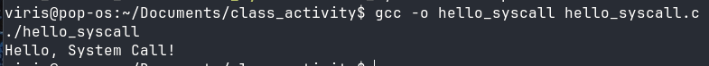

Screenshot of running `hello_winapi.c` on Windows (CMD/PowerShell/VS Code):

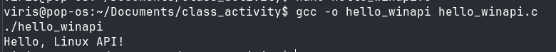

Screenshot of running `copyfilesyscall.c` on Linux:

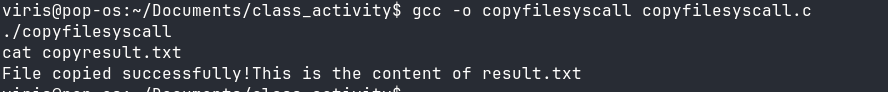

---

## Task 1: File Creator & Reader

### Part A — File Creator

**Describe your implementation:** I wrote `file_creator_sys.c` using the POSIX calls
`open()`, `write()`, and `close()` directly, while `file_creator_lib.c` uses the C
library functions `fopen()`, `fprintf()`, and `fclose()`. The library version is
shorter because the library hides the file descriptor and buffering details. In the
system-call version I had to choose the flags and permission mode myself, check the
returned descriptor, write the bytes explicitly, and close the descriptor. The
system-call version is unbuffered, so each `write()` goes to the kernel immediately.
Both versions create `output.txt` with the same contents.

**Version A — Library Functions (`file_creator_lib.c`):**

<!-- Screenshot: gcc -o file_creator_lib file_creator_lib.c && ./file_creator_lib && cat output.txt -->
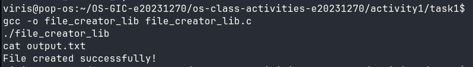

**Version B — POSIX System Calls (`file_creator_sys.c`):**

<!-- Screenshot: gcc -o file_creator_sys file_creator_sys.c && ./file_creator_sys && cat output.txt -->
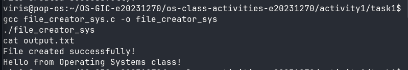

**Questions:**

1. **What flags did you pass to `open()`? What does each flag mean?**

   > I passed `O_WRONLY | O_CREAT | O_TRUNC` with mode `0644`.
   >
   > - `O_WRONLY` opens the file for writing only.
   > - `O_CREAT` creates the file if it does not already exist.
   > - `O_TRUNC` truncates the file to zero length if it already exists, so old
   >   contents are erased before the new text is written.
   >
   > The mode `0644` is applied when the file is created.

2. **What is `0644`? What does each digit represent?**

   > `0644` is an octal permission mode. The digits are the permissions for the file
   > owner, the group, and all other users:
   >
   > - `6` for the owner: `4` (read) + `2` (write) = `rw-`
   > - `4` for the group: read only = `r--`
   > - `4` for others: read only = `r--`
   >
   > The leading `0` means the number is written in octal. The process umask can
   > remove permission bits from this requested mode.

3. **What does `fopen("output.txt", "w")` do internally that you had to do manually?**

   > `fopen()` opens the file with the equivalent of
   > `open("output.txt", O_WRONLY | O_CREAT | O_TRUNC, 0666)`, with the real mode
   > reduced by the process umask. It also allocates a `FILE` stream and an internal
   > buffer, records the stream state, and returns a pointer to that stream. When the
   > buffer fills or `fclose()` is called, the library writes the buffered data with
   > `write()` and then closes the descriptor. In my system-call version I had to do
   > the `open()`, `write()`, and `close()` calls and handle the descriptor myself.

### Part B — File Reader & Display

**Describe your implementation:** `file_reader_sys.c` opens `output.txt` with
`O_RDONLY`, repeatedly calls `read()` into a 256-byte buffer, and writes each returned
chunk to standard output with `write()`. The loop ends when `read()` returns `0`
(end of file). `file_reader_lib.c` uses `fopen()` and `fgets()` to read the file one
line at a time through a buffered `FILE` stream, then prints each line with `printf()`.

**Version A — Library Functions (`file_reader_lib.c`):**

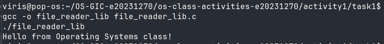

**Version B — POSIX System Calls (`file_reader_sys.c`):**

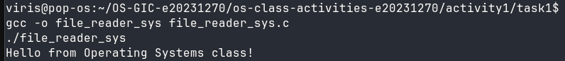

**Questions:**

1. **What does `read()` return? How is this different from `fgets()`?**

   > `read()` returns a `ssize_t`: the number of bytes actually read. It returns `0`
   > at end-of-file and `-1` on error. It does not add a null terminator, and it can
   > return fewer bytes than requested.
   >
   > `fgets()` returns a `char *` to the buffer on success or `NULL` on end-of-file
   > or error. It reads at most `size - 1` characters, stops after a newline or at
   > end-of-file, and always null-terminates the string. `fgets()` is line-oriented
   > and text-oriented, while `read()` is a raw byte-count operation.

2. **Why do you need a loop when using `read()`? When does it stop?**

   > A single `read()` call is not guaranteed to return the whole file; it returns up
   > to the requested number of bytes. A loop keeps reading until the whole file has
   > been processed. It stops when `read()` returns `0`, which means end-of-file. If
   > `read()` returns `-1`, an error occurred and the loop should also stop.

---

## Task 2: Directory Listing & File Info

**Describe your implementation:** `dir_list_lib.c` uses `opendir()`, `readdir()`, and
`stat()` to walk the current directory and prints each entry name and size with
`printf()`. `dir_list_sys.c` uses the same POSIX directory interface, but skips the
`.` and `..` entries, formats each row with `snprintf()`, and sends it to standard
output with `write()`. The POSIX functions `opendir()` and `readdir()` are themselves
library wrappers over the kernel's `getdents64()` system call, while `stat()` uses
`newfstatat()`.

### Version A — Library Functions (`dir_list_lib.c`)

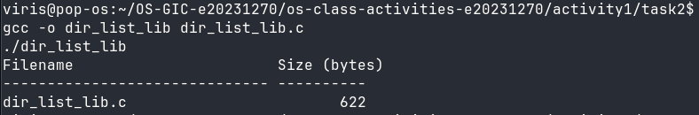

### Version B — System Calls (`dir_list_sys.c`)

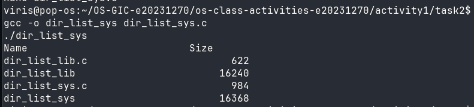

### Questions

1. **What struct does `readdir()` return? What fields does it contain?**

   > `readdir()` returns a pointer to a `struct dirent`. On Linux its important fields
   > are:
   >
   > - `d_ino`: the inode number of the entry
   > - `d_off`: the offset of the next entry in the directory
   > - `d_reclen`: the length of this directory record
   > - `d_type`: the entry type, such as `DT_REG`, `DT_DIR`, or `DT_LNK`
   > - `d_name`: the null-terminated file name
   >
   > The exact fields are implementation-dependent, and `d_type` is not supported on
   > every filesystem.

2. **What information does `stat()` provide beyond file size?**

   > `stat()` fills a `struct stat` with the file type and permission bits
   > (`st_mode`), inode number (`st_ino`), device ID (`st_dev`), number of hard links
   > (`st_nlink`), owner and group IDs (`st_uid`, `st_gid`), size (`st_size`),
   > preferred I/O block size (`st_blksize`), allocated blocks (`st_blocks`), and the
   > access, modification, and status-change timestamps (`st_atim`, `st_mtim`,
   > `st_ctim`). It therefore provides metadata, not just the file length.

3. **Why can't you `write()` a number directly — why do you need `snprintf()` first?**

   > `write()` sends raw bytes from memory. An `int` is stored in binary form, so
   > writing the bytes of an integer would produce binary data, not readable decimal
   > digits. `snprintf()` converts the integer into an ASCII string such as
   > `"12345"` and reports how many characters were produced. I can then pass that
   > string and its length to `write()`.

---

## Optional Bonus: Windows API (`file_creator_win.c`)

Screenshot of running on Windows:

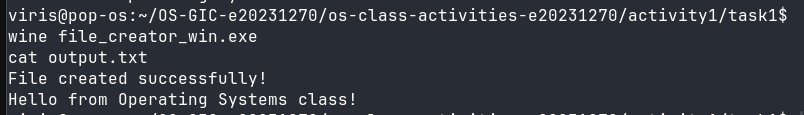

### Bonus Questions

1. **Why does Windows use `HANDLE` instead of integer file descriptors?**

   > A Windows `HANDLE` is an opaque, pointer-sized value that refers to an entry in
   > the kernel's object table. Handles can refer to files, pipes, events, processes,
   > threads, and other kernel objects. They carry access rights and security
   > information and are managed by the object manager. A POSIX file descriptor is a
   > small per-process integer index into a descriptor table. Windows uses handles
   > because its object model is broader and because access control and object
   > lifetime are enforced by the kernel.

2. **What is the Windows equivalent of POSIX `fork()`? Why is it different?**

   > Windows does not provide POSIX `fork()`. The usual equivalent for starting a new
   > program is `CreateProcess()`, which creates a new process and loads a specified
   > executable into it. `fork()` duplicates the calling process, including its
   > address space (usually with copy-on-write), and returns in both parent and child.
   > `CreateProcess()` does not duplicate the parent's address space; it creates a
   > fresh process from an executable image. Windows also supports process creation
   > through native APIs, but it does not expose traditional `fork()` semantics.

3. **Can you use POSIX calls on Windows?**

   > Not natively in the general case. The Microsoft C runtime provides some
   > underscore-prefixed calls such as `_open()`, `_read()`, and `_write()`, but
   > Windows does not implement the full POSIX API, and especially not `fork()`.
   > Full POSIX compatibility requires a compatibility layer such as Cygwin or MSYS2,
   > or a Linux environment such as WSL. With those layers, POSIX calls are translated
   > to Windows APIs or executed inside a Linux environment.

---

## Task 3: strace Analysis

**Describe what you observed:** I was surprised that even the direct system-call
program made 33 system calls. Most of those calls come from process startup and the
dynamic linker loading `libc`, not from my file code. The library version made 38
calls, so it made 5 more calls than the system-call version. The important file
operations were the same in both traces: `openat()`, `write()`, and `close()`. The
library version also showed extra startup work such as `fstat()`, `brk()`, and
`getrandom()`. The reader traces showed the same pattern, with the library reading
4096 bytes at a time through its buffer while my system-call reader requested 256
bytes at a time.

### strace Output — Library Version (File Creator)

<!-- Screenshot: strace -e trace=openat,read,write,close ./file_creator_lib -->
<!-- IMPORTANT: Highlight/annotate the key system calls in your screenshot -->
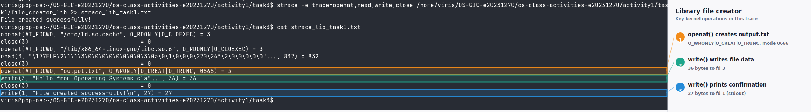

### strace Output — System Call Version (File Creator)

<!-- Screenshot: strace -e trace=openat,read,write,close ./file_creator_sys -->
<!-- IMPORTANT: Highlight/annotate the key system calls in your screenshot -->
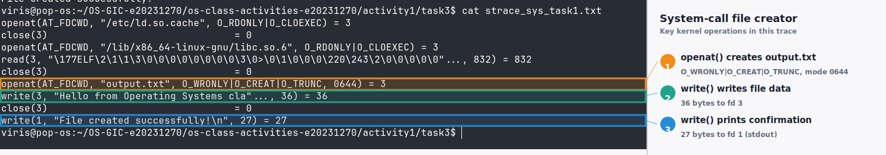

### strace Output — Library Version (File Reader or Dir Listing)

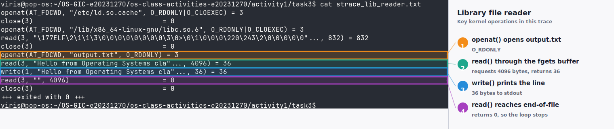

### strace Output — System Call Version (File Reader or Dir Listing)

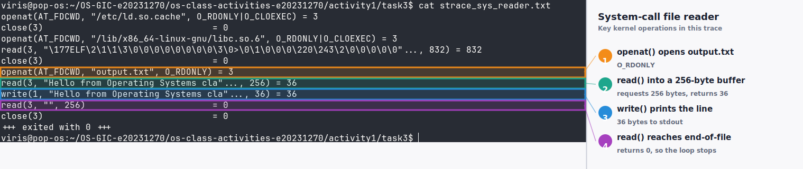

### strace -c Summary Comparison

<!-- Screenshot of `strace -c` output for both versions -->
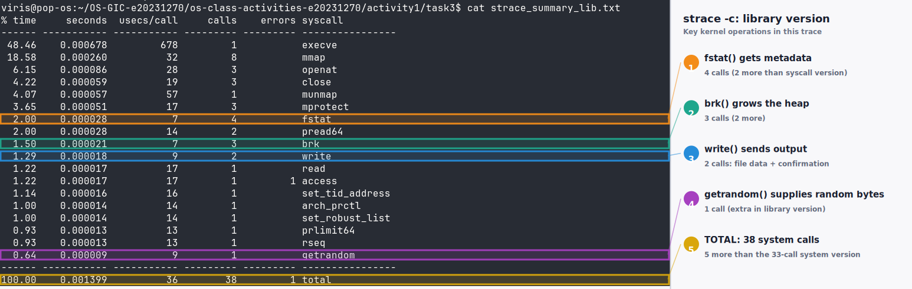
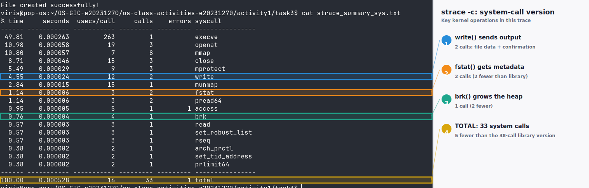

### Questions

1. **How many system calls does the library version make compared to the system call version?**

   > For the file creator, `strace -c` reported 38 calls for the library version and
   > 33 calls for the system-call version. The library version therefore made 5 more
   > calls, about 15% more. For the file reader, the filtered traces show the same
   > core calls (`openat`, `read`, `write`, `close`) in both versions, but the library
   > uses a 4096-byte buffered read while the system-call version uses 256 bytes.

2. **What extra system calls appear in the library version? What do they do?**

   > The extra calls in the library creator were two additional `fstat()` calls, two
   > additional `brk()` calls, and one `getrandom()` call. `fstat()` retrieves file
   > metadata for the standard streams; `brk()` adjusts the process heap as the
   > library allocates memory; and `getrandom()` supplies random bytes used during
   > runtime setup. Both versions also contain startup calls such as `mmap()`,
   > `mprotect()`, and `munmap()` for mapping libraries, `pread64()` for reading
   > library headers, `arch_prctl()` for thread-local storage, `set_tid_address()` and
   > `set_robust_list()` for thread cleanup, `prlimit64()` for resource limits, and
   > `rseq()` for restartable sequences. These are mostly dynamic-linker and C-runtime
   > initialization, not file I/O.

3. **How many `write()` calls does `fprintf()` actually produce?**

   > For the small message in this program, `fprintf()` produced one `write()` of 36
   > bytes, flushed when `fclose()` closed the stream. The separate `printf()` for the
   > success message produced one more `write()` of 27 bytes, so `strace -c` reports
   > two `write()` calls in total. The library buffers output, so one `fprintf()` call
   > does not necessarily mean one immediate `write()` call.

4. **In your own words, what is the real difference between a library function and a system call?**

   > A library function is ordinary user-space code that runs without changing
   > privilege level. It may do work entirely in user space, or it may eventually
   > invoke one or more system calls. A system call is a controlled entry into the
   > kernel: the CPU switches to kernel mode, the kernel validates the request, and
   > the caller receives a result. Library functions are convenient, portable, and
   > often buffered, but they do not have direct hardware access. System calls provide
   > the actual interface to kernel services, with more explicit control and more
   > responsibility for the programmer.

---

## Task 4: Exploring OS Structure

### System Information

> 📸 Screenshot of `uname -a`, `/proc/cpuinfo`, `/proc/meminfo`, `/proc/version`, `/proc/uptime`:

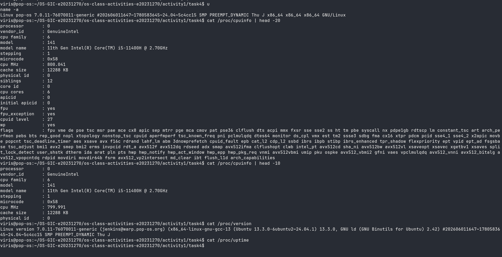

The captured system is Linux `7.0.11-76070011-generic` running on an Intel Core
i5-11400H with 6 cores and 12 hardware threads. `/proc/version` shows the kernel was
built with GCC 13.3.0, and `/proc/meminfo` reports `MemTotal: 16065756 kB`, which is
about 15.3 GiB.

### Process Information

> 📸 Screenshot of `/proc/self/status`, `/proc/self/maps`, `ps aux`:

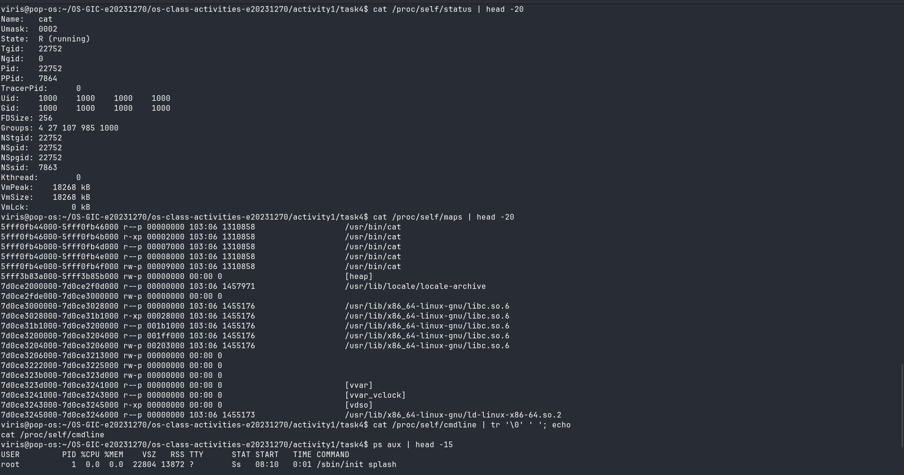

### Kernel Modules

> 📸 Screenshot of `lsmod` and `modinfo`:

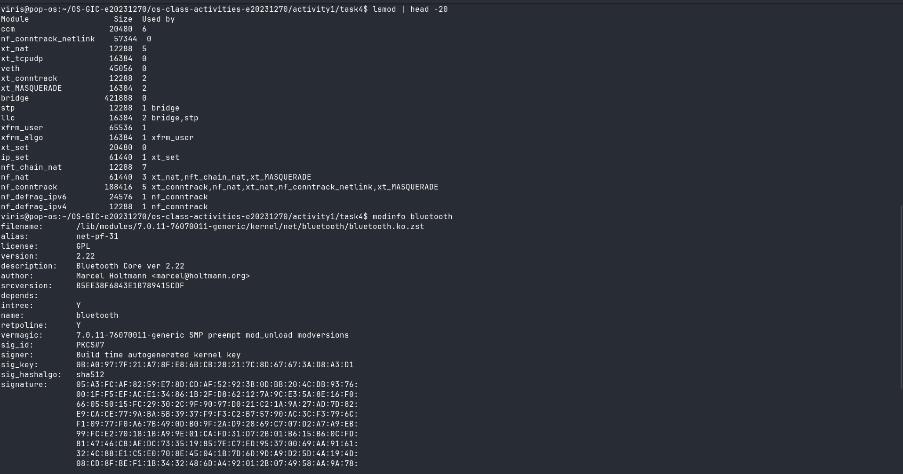

### OS Layers Diagram

> 📸 Your diagram of the OS layers, labeled with real data from your system:

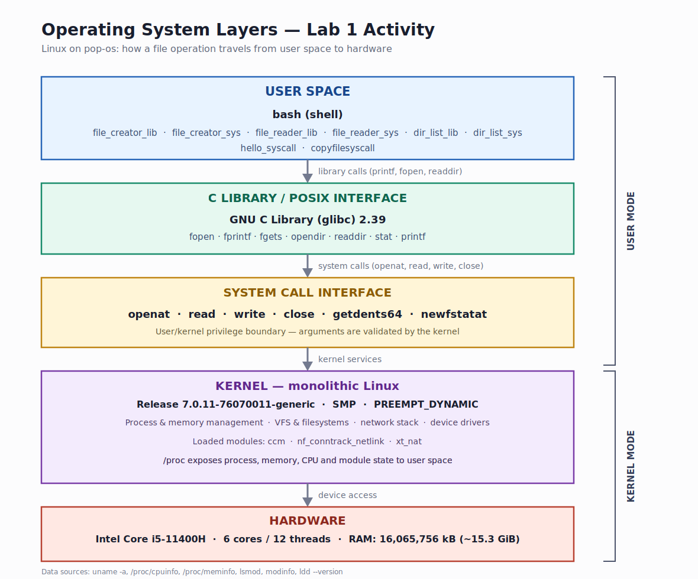

### Questions

1. **What is `/proc`? Is it a real filesystem on disk?**

   > `/proc` is a virtual filesystem (`procfs`) managed by the kernel. It is not a
   > real filesystem stored on a disk. Its files are generated when they are read and
   > represent kernel state, process state, and hardware information. For example,
   > `/proc/cpuinfo` is produced from the kernel's CPU data, and `/proc/self/status`
   > describes the process that is currently reading it.

2. **Monolithic kernel vs. microkernel — which type does Linux use?**

   > Linux is a monolithic kernel: the scheduler, memory manager, filesystems, device
   > drivers, and networking code all run in kernel space. It is also modular, because
   > drivers and other features can be loaded and unloaded as kernel modules (`.ko`
   > files). This is sometimes called a modular monolithic kernel. It is not a
   > microkernel, where most services would run as separate user-space processes and
   > communicate with the kernel through message passing.

3. **What memory regions do you see in `/proc/self/maps`?**

   > The first 20 lines show:
   >
   > - the `/usr/bin/cat` executable mapped with read-only, executable, read-only, and
   >   writable segments (`r--p`, `r-xp`, `r--p`, `rw-p`)
   > - the `[heap]`
   > - `/usr/lib/locale/locale-archive`
   > - several mappings of `libc.so.6` with read-only, executable, and writable
   >   segments, plus anonymous writable mappings
   > - `[vvar]`, `[vvar_vclock]`, and `[vdso]`, which support fast system calls and
   >   kernel-provided time data
   > - the dynamic loader `ld-linux-x86-64.so.2`
   >
   > A normal process also has a stack mapping and possibly more anonymous mappings
   > further down the file, but those are not shown in the first 20 lines of this
   > capture.

4. **Break down the kernel version string from `uname -a`.**

   > The string is:
   >
   > `Linux pop-os 7.0.11-76070011-generic #202606011647~1780583645~24.04~5c4cc15 SMP PREEMPT_DYNAMIC ... x86_64 GNU/Linux`
   >
   > - `Linux`: the kernel name.
   > - `pop-os`: the hostname of this machine.
   > - `7.0.11`: the kernel release/version.
   > - `76070011-generic`: the package revision and kernel flavor; `generic` is the
   >   standard general-purpose build.
   > - `#202606011647~1780583645~24.04~5c4cc15`: the build identifier. The number
   >   contains a build timestamp, an image/build identifier, the Ubuntu base version
   >   (`24.04`), and a short build revision.
   > - `SMP`: symmetric multiprocessing support, so the kernel can use multiple CPUs.
   > - `PREEMPT_DYNAMIC`: preemption behaviour can be selected dynamically.
   > - `x86_64`: the architecture is 64-bit x86.
   > - `GNU/Linux`: the operating-system platform.
   >
   > `/proc/version` adds that this kernel was built with GCC 13.3.0 and GNU ld 2.42.

5. **How does `/proc` show that the OS is an intermediary between programs and hardware?**

   > A program does not read the CPU, memory, or devices directly. Instead, it asks
   > the kernel through files in `/proc`. For example, `cat /proc/cpuinfo` causes the
   > kernel to gather and format CPU information; `/proc/self/status` exposes the
   > kernel's own task structure for the process; `/proc/self/maps` shows the page
   > tables the kernel maintains for that process; and `/proc/uptime` comes from
   > kernel timekeeping. The files look ordinary to the program, but they are produced
   > on demand by the kernel. Writing to files under `/proc/sys` similarly asks the
   > kernel to change a setting. `/proc` therefore demonstrates the kernel acting as
   > the controlled intermediary between user programs and the underlying hardware.

---

## Reflection

I learned that two programs can produce exactly the same visible result while making
different numbers and kinds of system calls. The library version was easier to write
because `fopen()` and `fprintf()` handled the descriptor, permissions, and buffering,
but `strace` showed that those conveniences added calls such as `fstat()`, `brk()`,
and `getrandom()`. The direct version made fewer total calls, and I had to manage the
descriptor, buffer, and error handling explicitly.

The most surprising difference was buffering. The library reader asked for 4096 bytes
at a time, while my system-call reader asked for 256. I also expected the
system-call version to make very few calls, but it still made 33 because the dynamic
linker and C runtime start before `main()`. This activity made the user-space/kernel
boundary concrete: library functions are convenient user-space code, but the actual
work reaches the kernel through system calls.
