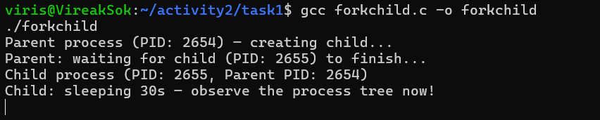
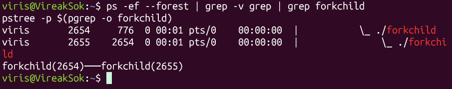
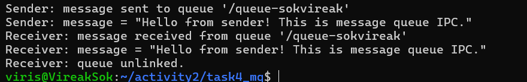
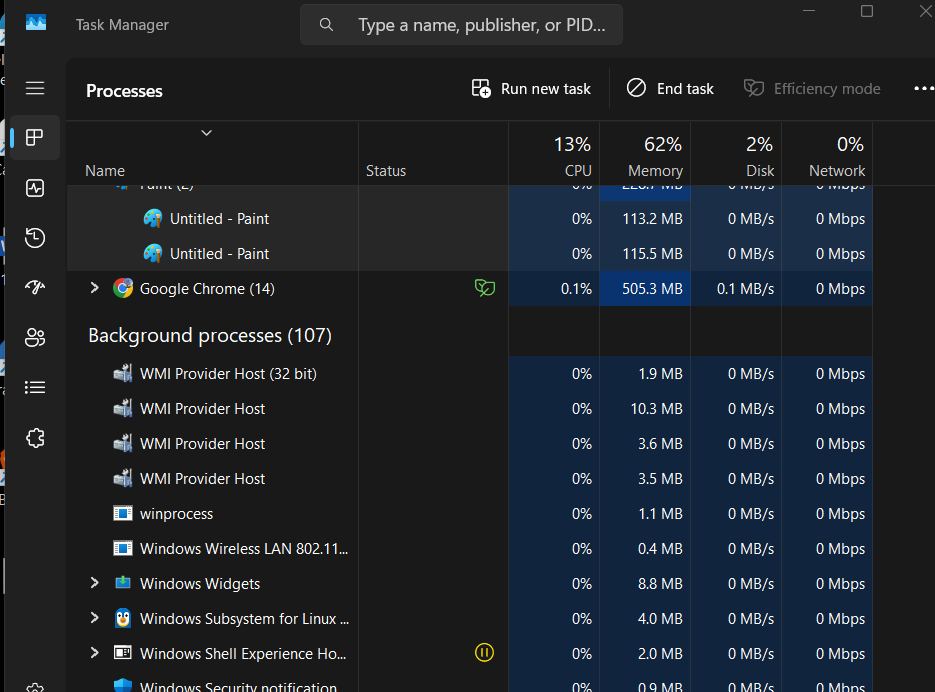
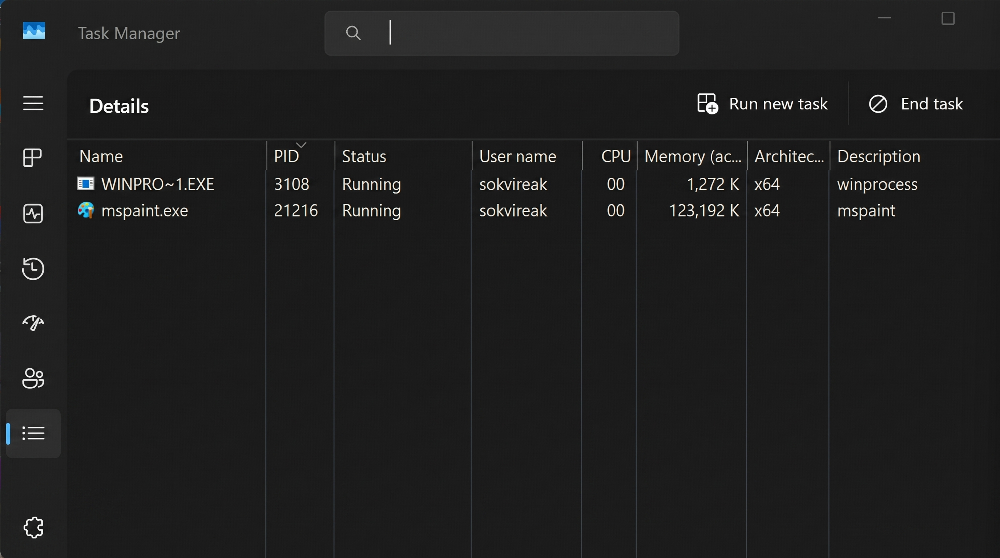
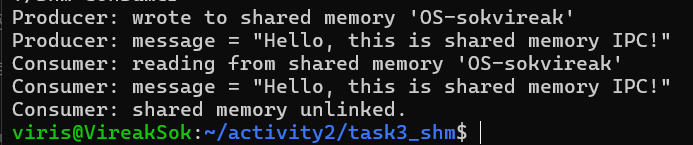
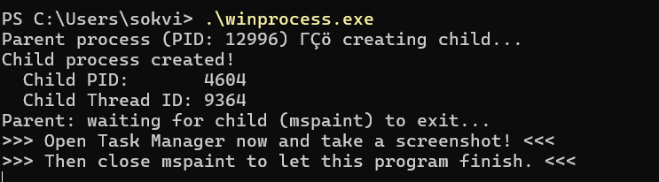

# Class Activity 2 — Processes & Inter-Process Communication

- **Student Name:** Sok Vireak
- **Student ID:** e20231270
- **Date:** 2026-10-29

---

## Task 1: Process Creation on Linux (fork + exec)

### Compilation & Execution

Screenshot of compiling and running `forkchild.c`:



### Process Tree

Screenshot of the parent-child process tree (using `ps --forest`, `pstree`, or `htop` tree view):



### Output

```
Parent process (PID: 2392) — creating child...
Parent: waiting for child (PID: 2393) to finish...
Parent: child exited with status 0
Parent: done.
```

### Questions

1. **What does `fork()` return to the parent? What does it return to the child?**

   > `fork()` returns the child's PID (a positive integer, e.g., 2393) to the parent process, and returns `0` to the child process. If `fork()` fails, it returns `-1` to the parent and no child is created.

2. **What happens if you remove the `waitpid()` call? Why might the output look different?**

   > If `waitpid()` is removed, the parent process will not wait for the child to finish and will continue executing immediately. This means the parent may print "Parent: done." before the child finishes its work. The child process could become an **orphan process** (adopted by `init`/PID 1) or a **zombie process** (if it finishes but no one collects its exit status). The output order becomes non-deterministic.

3. **What does `execlp()` do? Why don't we see "execlp failed" when it succeeds?**

   > `execlp()` replaces the current process's memory image with a new program (in this case, `ls -la`). When it succeeds, the old program code is completely replaced, so the line `perror("execlp")` no longer exists in memory — it never executes. We only see "execlp failed" if the call fails (e.g., if the command is not found).

4. **Draw the process tree for your program (parent → child). Include PIDs from your output.**

   > ```
   > forkchild (PID: 2392) [Parent]
   >     └── forkchild (PID: 2393) [Child] → execlp("ls") replaces this process
   > ```

5. **Which command did you use to view the process tree (`ps --forest`, `pstree`, or `htop`)? What information does each column show?**

   > I used `pstree -p` and `ps -ef --forest`. `ps -ef --forest` shows: UID (user), PID (process ID), PPID (parent process ID), C (CPU usage), STIME (start time), TTY (terminal), TIME (CPU time), and CMD (command with tree indentation showing parent-child relationships).

---

## Task 2: Process Creation on Windows

### Compilation & Execution

Screenshot of compiling and running `winprocess.c`:



### Task Manager Screenshots

Screenshot showing process tree in the **Processes** tab (mspaint nested under your program):



> **Note:** On Windows 11, Paint is a modern Store (UWP) app. Task Manager's Processes tab separates windowed apps from background console processes, so `mspaint.exe` appears under "Apps" while `winprocess.exe` appears under "Background processes." The parent-child relationship is confirmed in the Details tab below.

Screenshot showing PID and Parent PID in the **Details** tab:



### Questions

1. **What is the key difference between how Linux creates a process (`fork` + `exec`) and how Windows does it (`CreateProcess`)?**

   > Linux uses a **two-step model**: `fork()` creates an exact copy (clone) of the parent process, then `exec()` replaces the child's memory with a new program. Windows uses a **single-step model**: `CreateProcess()` creates a brand-new process and loads the specified executable into it in one call — there is no cloning of the parent.

2. **What does `WaitForSingleObject()` do? What is its Linux equivalent?**

   > `WaitForSingleObject()` blocks the calling thread until the specified object (in this case, the child process handle) is signaled (i.e., the child exits). Its Linux equivalent is `waitpid()` or `wait()`, which blocks the parent until the child process terminates.

3. **Why do we need to call `CloseHandle()` at the end? What happens if we don't?**

   > `CloseHandle()` releases the kernel object handles for the child process and its primary thread. If we don't call it, these handles remain open, causing a **handle leak** — the kernel keeps the process/thread objects in memory even after they've exited. Over time, this wastes system resources and could exhaust the system's handle limit.

4. **In Task Manager, what was the PID of your parent program and the PID of mspaint? Do they match your program's output?**

   > The parent program (`winprocess.exe`) had **PID: 21028** and `mspaint.exe` had **PID: 8712**. Yes, these match the output printed by the program: `Parent process (PID: 21028)` and `Child PID: 8712`.

5. **Compare the Processes tab (tree view) and the Details tab (PID/PPID columns). Which view makes it easier to understand the parent-child relationship? Why?**

   > The **Details tab** with PID and Parent PID columns makes it easier to understand the parent-child relationship because it explicitly shows the numerical Parent PID of each process, allowing you to directly verify that `mspaint.exe`'s Parent PID matches `winprocess.exe`'s PID. The Processes tab tree view is more intuitive visually but on Windows 11, modern Store apps (like Paint) are grouped separately from console apps, which can hide the parent-child nesting.

---

## Task 3: Shared Memory IPC

### Compilation & Execution

Screenshot of compiling and running `shm-producer` and `shm-consumer`:



### Output

```
Consumer: reading from shared memory 'OS-sokvireak'
Consumer: message = "Hello, this is shared memory IPC!"
Consumer: shared memory unlinked.
```

### Questions

1. **What does `shm_open()` do? How is it different from `open()`?**

   > `shm_open()` creates or opens a POSIX shared memory object that resides in a special in-memory filesystem (`/dev/shm`), not on disk. `open()` creates or opens a regular file on disk. Shared memory objects are designed for fast inter-process communication because they live entirely in RAM, whereas regular files involve slower disk I/O.

2. **What does `mmap()` do? Why is shared memory faster than other IPC methods?**

   > `mmap()` maps the shared memory object into the calling process's virtual address space, allowing the process to read/write the shared memory as if it were a regular array or buffer in memory. Shared memory is faster than other IPC methods (like pipes or message queues) because data is not copied between user space and kernel space — both processes access the same physical memory region directly, with zero copying overhead.

3. **Why must the shared memory name match between producer and consumer?**

   > The shared memory name (e.g., `"OS-sokvireak"`) acts as a unique identifier in the system's shared memory namespace. Both the producer and consumer must use the exact same name so they reference the same shared memory object. If the names don't match, the consumer would try to open a non-existent object and fail with an error.

4. **What does `shm_unlink()` do? What would happen if the consumer didn't call it?**

   > `shm_unlink()` removes the shared memory object's name from the system, marking it for deletion. The actual memory is freed once all processes that have it mapped call `munmap()` or exit. If the consumer doesn't call it, the shared memory object persists in `/dev/shm` until the system reboots or someone manually removes it, wasting memory resources.

5. **If the consumer runs before the producer, what happens? Try it and describe the error.**

   > If the consumer runs before the producer, `shm_open()` with `O_RDONLY` fails because the shared memory object doesn't exist yet. The program prints: `shm_open: No such file or directory` followed by `Hint: Did you run shm-producer first?` and exits with a failure status.

---

## Task 4: Message Queue IPC

### Compilation & Execution

Screenshot of compiling and running `sender` and `receiver`:



### Output

```
Receiver: message received from queue '/queue-sokvireak'
Receiver: message = "Hello from sender! This is message queue IPC."
Receiver: queue unlinked.
```

### Questions

1. **How is a message queue different from shared memory? When would you use one over the other?**

   > A message queue provides **structured, discrete messages** with built-in synchronization — messages are sent and received one at a time, and the kernel handles queuing and ordering. Shared memory provides a **raw block of memory** with no built-in structure or synchronization (you must add your own locks). Use message queues when you need simple, reliable message passing with ordering guarantees. Use shared memory when you need high-speed, high-volume data transfer and are willing to manage synchronization yourself.

2. **Why does the queue name in `common.h` need to start with `/`?**

   > This is a POSIX requirement. POSIX message queue names must begin with a forward slash `/` to indicate they are in the system-wide namespace (similar to how file paths start with `/`). The name after the slash must not contain additional slashes. Omitting the leading `/` results in an `EINVAL` error.

3. **What does `mq_unlink()` do? What happens if neither the sender nor receiver calls it?**

   > `mq_unlink()` removes the message queue's name from the system and marks it for deletion (it is destroyed once all processes close it). If neither calls it, the message queue persists in the system (under `/dev/mqueue/`) until a reboot or manual deletion, occupying kernel resources unnecessarily.

4. **What happens if you run the receiver before the sender?**

   > If the receiver runs before the sender, `mq_open()` with `O_RDONLY` fails because the queue hasn't been created yet. The program prints: `mq_open: No such file or directory` followed by `Hint: Did you run sender first?` and exits with a failure status.

5. **Can multiple senders send to the same queue? Can multiple receivers read from the same queue?**

   > Yes to both. Multiple senders can open the same queue and send messages to it — messages are appended to the queue. Multiple receivers can also read from the same queue, but each message is consumed by only one receiver (the first one to call `mq_receive()` gets it). This makes message queues naturally suited for **work distribution** (producer-consumer) patterns.

---

## Reflection

> In this activity, I learned how processes are created and how inter-process communication works on both Linux and Windows. The most interesting difference was how Linux uses a two-step `fork()` + `exec()` model (cloning the parent first, then replacing the child's image) while Windows uses a single-step `CreateProcess()` that directly creates a new process. For IPC, I found **message queues** more intuitive because they provide built-in message ordering and synchronization without needing manual locks, whereas shared memory is faster but requires more careful coordination between processes. Overall, this activity gave me a solid understanding of how the operating system manages processes and enables communication between them.
