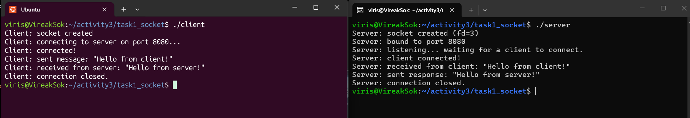
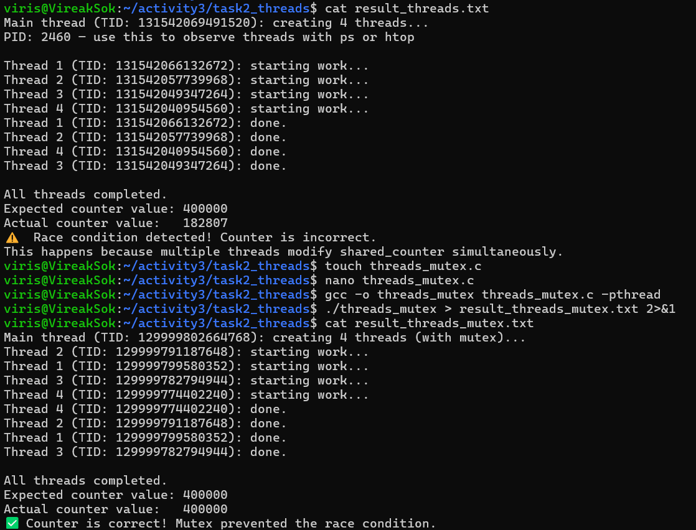
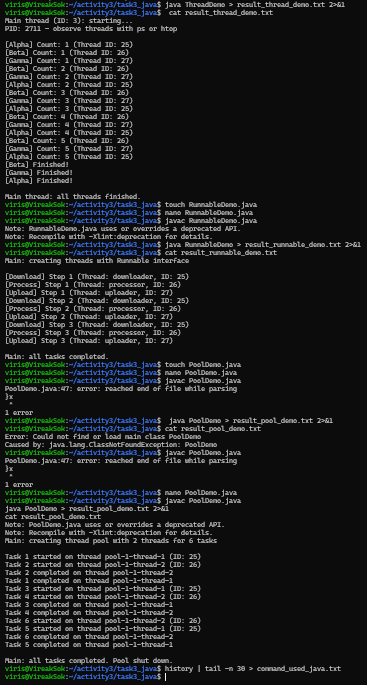
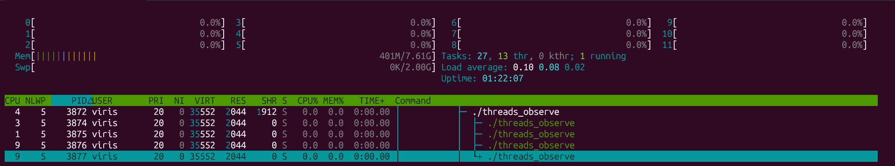
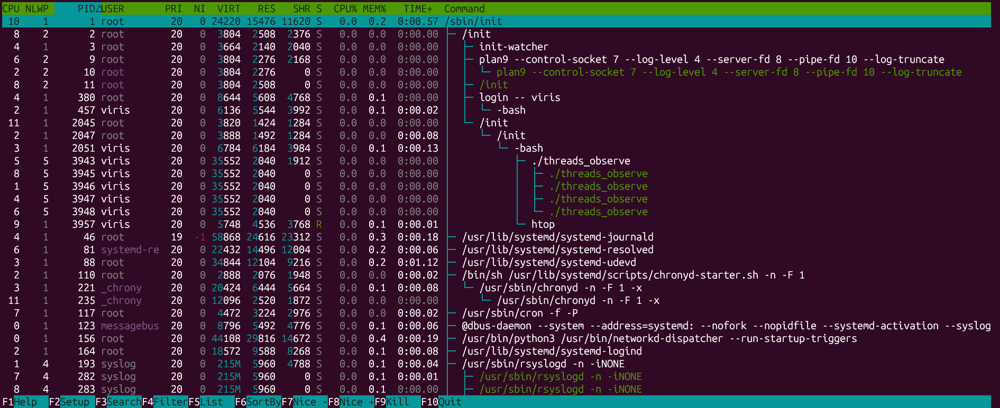
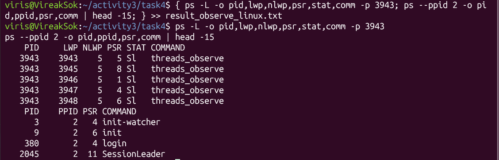
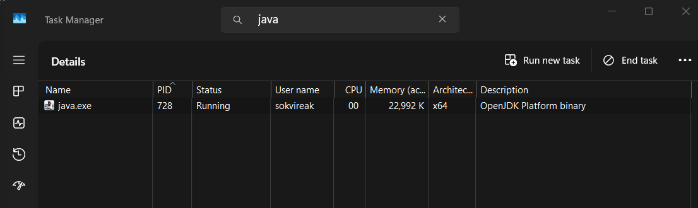
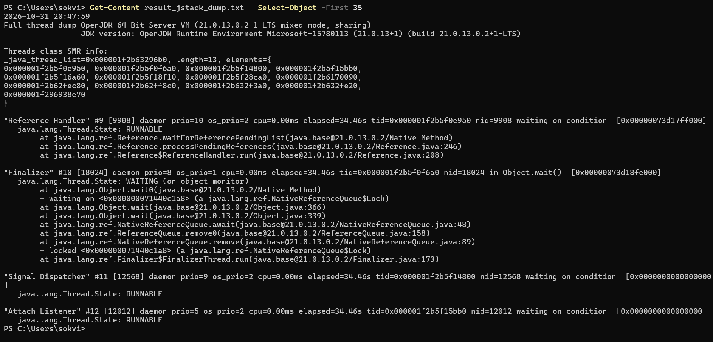

# Class Activity 3 — Socket Communication & Multithreading

- **Student Name:** Sok Vireak
- **Student ID:** e20231270
- **Date:** 2026-10-31

---

## Task 1: TCP Socket Communication (C)

### Compilation & Execution



### Answers

1. **Role of `bind()` / Why client doesn't call it:**
   > `bind()` binds the socket descriptor to a specific local IP address (`INADDR_ANY`) and port number (`8080`). This provides the server with a well-known, fixed address that clients can connect to.  
   > The client does not call `bind()` because it does not need a predefined port. When the client calls `connect()`, the operating system kernel automatically assigns an unused ephemeral port (a temporary port dynamically selected from the OS ephemeral port range) to the client socket.

2. **What `accept()` returns:**
   > `accept()` returns a **newly created socket file descriptor** dedicated exclusively to the accepted connection with that specific client.  
   > This is different from the original server socket (`server_fd`), which remains open in the listening state to accept future incoming connection requests from other clients.

3. **Starting client before server:**
   > When starting `./client` before `./server` is listening, `connect()` fails with:
   > `connect: Connection refused` (errno `ECONNREFUSED`).  
   > This occurs because there is no process listening on destination port 8080, causing the OS TCP stack to reject the connection request immediately by replying with a TCP RST (reset) packet.

4. **What `htons()` does:**
   > `htons()` stands for **Host to Network Short**. It converts a 16-bit unsigned integer from Host Byte Order (little-endian on x86-64 / WSL) to Network Byte Order (big-endian).  
   > Byte order conversion is necessary because different CPU architectures represent multi-byte integers differently in memory. Using standardized big-endian network byte order guarantees that port numbers are correctly understood across different machines and networks.

5. **Socket call sequence diagram:**
   > ```text
   > Server (Passive Socket)                        Client (Active Socket)
   >  ──────────────────────                        ──────────────────────
   >       socket()                                       socket()
   >          │                                              │
   >       bind()                                            │
   >          │                                              │
   >       listen()                                          │
   >          │                                              │
   >       accept() [blocks] ◄───── TCP 3-Way Handshake ───── connect()
   >          │                (SYN, SYN-ACK, ACK)           │
   >          │                                              │
   >       read()   [blocks] ◄──────── Application Data ────── send("Hello from client!")
   >          │                                              │
   >       send("Hello from server!") ── Application Data ──► read() [blocks]
   >          │                                              │
   >       close()  ─────────────── TCP Teardown ───────────► close()
   > ```

---

## Task 2: POSIX Threads (C)

### Output — Without Mutex (Race Condition)



### Output — With Mutex (Correct)

*(Included in the screenshot above, showing both runs side by side)*

### Answers

1. **What is a race condition?**
   > A race condition occurs when multiple threads concurrently access and modify shared data without synchronization, causing the final output to depend on the non-deterministic scheduling and timing of the threads.  
   > In `threads.c`, `shared_counter++` is not an atomic operation. At the CPU instruction level, it requires three separate operations:
   > 1. Read `shared_counter` from RAM into a CPU register.
   > 2. Increment the register value.
   > 3. Write the updated value back from the register to RAM.  
   > When multiple threads run simultaneously across multiple CPU cores, their read-modify-write sequences interleave, causing updates to overwrite each other. As a result, the actual counter value (`182807`) is significantly lower than the expected `400000`.

2. **What does `pthread_mutex_lock()` do?**
   > `pthread_mutex_lock()` acquires exclusive ownership of the mutex. If the mutex is already locked by another thread, the calling thread blocks until the holding thread releases it with `pthread_mutex_unlock()`.  
   > It fixes the race condition by enforcing **mutual exclusion** on the critical section (`shared_counter++`), ensuring that exactly one thread can read, modify, and store the counter at any given time.

3. **Removing `pthread_join()`:**
   > `pthread_join()` forces the main thread to block until all created worker threads complete their execution.  
   > If `pthread_join()` is removed, the main thread continues immediately after spawning the threads, prints the counter before the threads have finished (or even started) their work, and exits via `return 0;`. Exiting `main()` terminates the entire process, killing all background worker threads prematurely.

4. **Thread vs Process:**
   > A **process** is an independent executing program with its own private virtual memory space, file descriptor table, and isolated system resources. A **thread** is a lightweight unit of execution within a process that can be scheduled independently by the OS kernel.  
   > - **Shared among threads in a process:** Virtual memory address space (heap, global and static variables), code/text segment, open file descriptors, and process ID (PID).  
   > - **Private to each thread:** Unique Thread ID (TID / LWP), processor registers, program counter (PC), and call stack (local variables and stack frames).

---

## Task 3: Java Multithreading

### ThreadDemo Output



### RunnableDemo Output

*(Included in the screenshot above)*

### PoolDemo Output

*(Included in the screenshot above)*

### Answers

1. **Thread vs Runnable:**
   > - **Extending `Thread`:** The class inherits directly from `Thread` and overrides `run()`. Because Java does not support multiple inheritance of classes, extending `Thread` prevents the class from subclassing any other class.
   > - **Implementing `Runnable`:** Separates the task logic (`run()`) from the execution mechanism (`Thread`). The class can still extend other classes, and tasks can easily be submitted to thread pools or executors.  
   > - **Preference:** Implementing `Runnable` (or `Callable`) is strongly preferred in real-world applications because it provides loose coupling, promotes code reuse, and integrates cleanly with the Java Concurrency Framework (`ExecutorService`).

2. **Pool size limiting concurrency:**
   > In `PoolDemo`, `Executors.newFixedThreadPool(2)` allocates a pool with a maximum capacity of 2 active worker threads. When 6 tasks are submitted, the first 2 tasks run concurrently on `pool-1-thread-1` and `pool-1-thread-2`. The other 4 tasks wait in an internal FIFO queue (`LinkedBlockingQueue`). As soon as an active thread completes its task, it picks up the next task from the queue, ensuring no more than 2 tasks execute at any single time.

3. **thread.join() in Java:**
   > In Java, `thread.join()` causes the calling thread (here, `main`) to wait until the target thread terminates.  
   > If `join()` is removed from `ThreadDemo`, the `main` thread does not wait; it immediately prints `Main thread: all threads finished.` while the background worker threads (`Alpha`, `Beta`, `Gamma`) are still sleeping and printing their iterations.

4. **ExecutorService advantages:**
   > - **Thread Reuse:** Avoids the heavy CPU and memory overhead of creating and destroying native threads for each task.
   > - **Resource Governance:** Limits the maximum number of concurrent threads, preventing thread starvation, out-of-memory errors, and excessive CPU context-switching under heavy workload.
   > - **High-Level Management:** Provides out-of-the-box support for task queues, futures, callable tasks with return values, scheduled execution, and clean thread pool lifecycle shutdown.

---

## Task 4: Observing Threads

### Linux — `ps -eLf` Output

```text
viris       3381    2051    3381  0    5 20:05 pts/2    00:00:00 ./threads_observe
viris       3381    2051    3384  0    5 20:05 pts/2    00:00:00 ./threads_observe
viris       3381    2051    3385  0    5 20:05 pts/2    00:00:00 ./threads_observe
viris       3381    2051    3386  0    5 20:05 pts/2    00:00:00 ./threads_observe
viris       3381    2051    3387  0    5 20:05 pts/2    00:00:00 ./threads_observe
```

### Linux — htop Thread View



### Linux — htop Kernel Threads (tree view, `kthreadd`)



### Linux — Kernel Threads (commands)



Output from `ps -L` and `ps --ppid 2`:
```text
    PID     LWP NLWP PSR STAT COMMAND
   3943    3943    5   5 Sl   threads_observe
   3943    3945    5   8 Sl   threads_observe
   3943    3946    5   1 Sl   threads_observe
   3943    3947    5   4 Sl   threads_observe
   3943    3948    5   6 Sl   threads_observe

    PID    PPID PSR COMMAND
      3       2   4 init-watcher
      9       2   6 init
    380       2   4 login
   2045       2  11 SessionLeader
```

### Windows — Task Manager



*(Advanced JDK thread verification via `jstack`)*:



### Answers

1. **LWP column meaning:**
   > In Linux, **LWP** stands for **Light Weight Process**. Linux utilizes the 1:1 threading model (Native POSIX Thread Library, NPTL) where each POSIX thread created in user space is scheduled as an individual LWP by the Linux kernel scheduler. The LWP number is the unique thread identifier (TID).

2. **/proc/PID/task/ count:**
   > In `/proc/3442/task/`, there were **5 directory entries**: `3442`, `3444`, `3445`, `3446`, and `3447`.  
   > This exactly matches the program structure: 1 initial main thread plus 4 worker threads.

3. **Extra Java threads:**
   > In Task Manager and `jstack`, `java.exe` shows 13 threads instead of just the 2 or 3 application threads. The JVM automatically starts and manages background daemon threads for runtime maintenance:
   > - **Garbage Collection (GC) threads** for automated heap memory collection.
   > - **Reference Handler** for queueing cleared references.
   > - **Finalizer** for executing object finalization routines.
   > - **Signal Dispatcher** to capture OS signals (e.g., SIGTERM, SIGINT).
   > - **Attach Listener** for external inspection utilities (e.g., jstack, jconsole).
   > - **C1/C2 CompilerThreads** for Just-In-Time (JIT) bytecode optimization.
   > - **Service Thread** and **Monitor Deflation Thread**.

4. **Linux vs Windows thread viewing:**
   > - **Linux:** Provides direct, granular OS-level thread visibility through native utilities and virtual file systems (`/proc/<PID>/task/`, `ps -eLf`, `top -H`, and `htop`). Each thread's individual status, core affinity (PSR), scheduling priority, and LWP ID are readily inspectable.
   > - **Windows Task Manager:** Focuses on process-centric metrics and aggregates thread count per process in the Details tab. While convenient for high-level monitoring, inspecting individual thread IDs, call stacks, and thread states requires specialized developer tools like Sysinternals Process Explorer, WinDbg, or JDK `jstack`.

5. **kthreadd and three kernel threads:**
   > `kthreadd` has **PID 2** and is the kernel thread daemon responsible for creating all kernel-level worker threads.  
   > In WSL2, PID 2 is managed through WSL's init environment, listing child processes such as `init-watcher` (PID 3), `init` (PID 9), and `login` (PID 380).  
   > On standard Linux systems, kernel threads have names enclosed in brackets (e.g., `[ksoftirqd/0]`, `[rcu_sched]`, `[kworker/0:0]`), a PPID of 2, and zero virtual memory size (`VSZ = 0`) because they operate entirely in kernel address space without a user-space memory mapping.

6. **TID equal to PID, NLWP and cores:**
   > - The thread whose **TID/LWP equals the PID** (`3943`) is the **main thread** (thread leader).
   > - **NLWP** stands for **Number of Light Weight Processes**, which is **5** (1 main thread + 4 worker threads).
   > - From the `PSR` / `PROCESSOR` columns in the outputs, the threads were actively scheduled across CPU cores: Core 5 (main), Core 8 (worker 1), Core 1 (worker 2), Core 4 (worker 3), and Core 6 (worker 4).

7. **`H` and `K` in htop:**
   > - **`H`:** Toggles user thread visibility. Without `H`, all user threads belonging to a process are collapsed into a single row.
   > - **`K`:** Toggles kernel thread visibility. Without `K`, kernel threads (children of `kthreadd`) are hidden from the process listing.

---

## Reflection

> Working with TCP sockets and multithreading highlighted how modern operating systems handle communication and concurrency at both the boundary between processes and within a single process. Sockets demonstrated the fundamentals of network IPC—how processes synchronize via handshakes and communicate across standard interfaces. Meanwhile, experimenting with POSIX threads revealed the realities of the memory model: while threads offer significant performance benefits through shared memory, non-atomic operations quickly lead to race conditions without synchronization primitives like mutexes.
> 
> Observing threads at the OS level using tools like `ps`, `htop`, `/proc`, and Task Manager demystified the abstraction of concurrent code. Seeing how the kernel assigns LWPs, distributes them across physical CPU cores (PSR), and manages its own background kernel threads (`kthreadd`) reinforces why thread pools, locking granularity, and synchronization patterns are critical for writing scalable, bug-free concurrent software.
